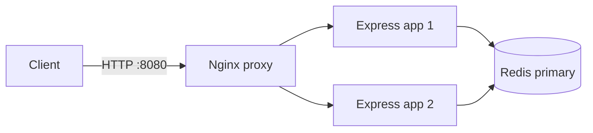

# Architecture and operations

## Runtime topology



Compose publishes only the Nginx port, bound to localhost. Redis and both app instances are on the internal backend network; Nginx also joins the edge network to publish the proxy port. The app containers run as the unprivileged `node` user. Both app instances share the same Redis primary and environment namespace, so their decisions use common counters.

Nginx replaces `X-Forwarded-For` with the address it observed. The app trusts one proxy hop in Compose and trusts no forwarded hops by default when run directly. Do not expose app or Redis ports outside their intended network.

## Request and admission flow

```mermaid
sequenceDiagram
    participant C as Client
    participant N as Nginx
    participant A as Express instance
    participant R as Redis
    C->>N: HTTP request
    N->>A: Forward request and overwrite forwarding headers
    A->>A: Normalize client IP; resolve optional demo API key
    A->>R: EVALSHA with policy keys, limits, and windows
    R->>R: Use Redis TIME, prune expired events, evaluate all policies
    alt Every policy admits
        R->>R: Record one UUID event per policy and set expirations
        R-->>A: Allowed result and remaining quota
        A-->>C: Route response with RateLimit headers
    else Any policy blocks
        R-->>A: Rejected result and retry duration; no event is added
        A-->>C: HTTP 429 with Retry-After
    else Redis decision fails
        A-->>C: HTTP 503, or admit with an explicit bypass header
    end
```

`/api/account` first resolves the demo bearer key to a stable configured user ID, then checks both IP and user policies. Public requests use the IP policy; `/api/scoped` adds a route-specific IP policy. The demo authentication map is illustrative and is not production authentication.

## Sliding-window state

Each policy is stored in a Redis sorted set. A key combines the application environment, policy name, scope, and a SHA-256 digest of the scope and identity; raw IP addresses and user IDs are not placed in keys. Hashing reduces direct exposure but is not encryption, so Redis access still needs protection.

The Lua script obtains time from Redis, removes scores at or before `now - window`, and checks every policy before adding the request. If any policy blocks, no new event is added to any policy key. Otherwise the script inserts the same unique UUID into each applicable sorted set and sets key expiry to the policy window. The single script execution makes the multi-policy decision atomic across both app instances. `Retry-After` is based on the latest next-admission time among blocking policies.

The application loads the Lua script at startup and uses `EVALSHA`. It reloads the script once after `NOSCRIPT`; other errors and timed-out commands are not retried. A command timeout can be an uncertain outcome: Redis may have recorded the admission even though the app returns HTTP 503.

## Failure behavior and observability

- `REDIS_FAILURE_MODE=closed` is the default: an unavailable decision returns HTTP 503, not 429.
- `REDIS_FAILURE_MODE=open` admits the request with `X-Rate-Limit-Bypassed: true`; this deliberately bypasses quota enforcement.
- Redis connection and limiter-command waits are bounded. Offline command queuing is disabled and reconnect delays are capped.
- `/health/live` reports process liveness. `/health/ready` returns 503 when the Redis client is not ready.
- `/metrics` exposes process-local, in-memory Prometheus counters and a latency histogram with fixed outcome labels. Metrics reset when a process restarts and are not aggregated across app instances.

## Local validation

Start a local Redis instance and run the app with `npm start`, or use the Compose proxy. The development checks are:

```powershell
npm ci
docker compose -f docker-compose.yml -f docker-compose.test.yml up -d redis
npm run lint
npm audit
npm test
npm run test:distributed
npm run test:load
```

The GitHub Actions workflow starts from a clean checkout and runs the same test, audit, distributed, and load checks. Load-test throughput and latency are measurements of the current environment, not service-level guarantees.

## Current boundaries

- One Redis primary is supported; Redis Cluster, automatic failover, and persistence guarantees are not implemented.
- Rate-limit state is shared across the two app instances, but metrics are process-local.
- The demo API-key adapter and illustrative credentials are for demonstration only. Production deployment needs real authentication, secret management, TLS, Redis access controls, and an operational availability strategy.
